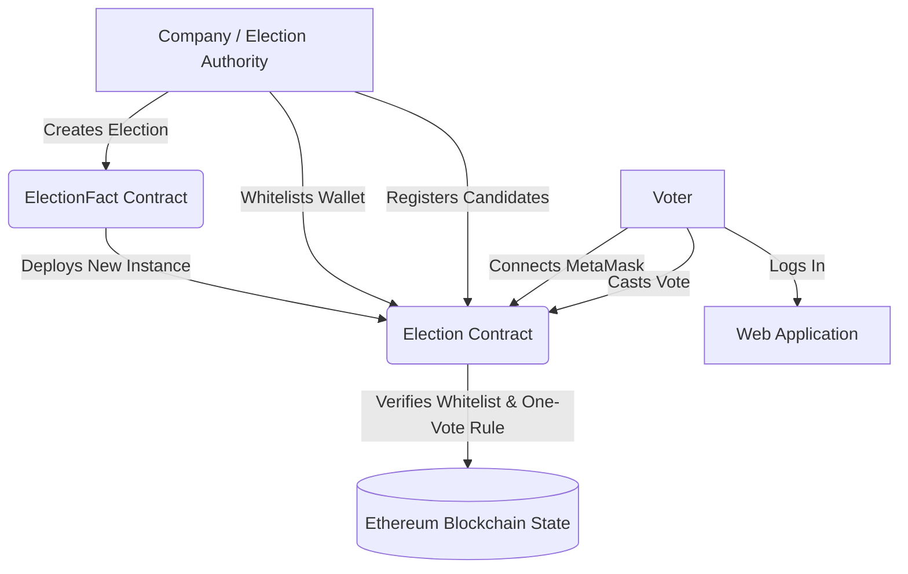

# Vote.sys — Blockchain-Based E-Voting System

A secure, decentralized electronic voting application built on the **Ethereum Blockchain**, powered by **Next.js**, **Express**, **MongoDB**, and **Web3.js**. 

The system guarantees transparency, election integrity, and tamper-proof voting records through smart contract-enforced voter whitelisting and double-voting prevention.

---

## 🏛️ System Architecture



* **Smart Contracts (`Solidity ^0.8.19`):**
  * `ElectionFact`: Factory contract managing company elections and deployed contract addresses.
  * `Election`: Instance contract managing candidate listings, whitelisted voter addresses, real-time vote aggregation, and election status (`active` / `ended`).
* **Frontend:** Next.js, React, Semantic UI React, Chart.js live visual analytics.
* **Backend:** Express.js REST API for voter credential management and session state.
* **Database:** MongoDB for voter records and administrative authentication.
* **Web3 Integration:** Web3.js with MetaMask browser extension provider.

---

## 📋 Prerequisites

Before running the project, ensure you have the following installed:

1. **Node.js**: v18+ (tested up to v22)
2. **MongoDB Community Server**: Running locally on port `27017`
3. **MetaMask Extension**: Installed in your browser (Brave, Chrome, Firefox, or Edge)
4. **Git**: Installed for version control

---

## ⚙️ Quick Start Guide

### 1. Clone & Install Dependencies

```bash
git clone https://github.com/skg2k05/Vote.sys.git
cd Vote.sys
npm install
```

### 2. Configure Environment Variables

Create a `.env` file in the project root:

```env
# Optional: Gmail SMTP credentials for automated email notifications
EMAIL=
PASSWORD=

# MongoDB connection URI
MONGODB_URI=mongodb://127.0.0.1:27017/BlockVotes

# Blockchain RPC endpoint
RPC_URL=http://127.0.0.1:8545

# Optional: Mnemonic for public testnet deployment (leave empty for local Ganache)
MNEMONIC=
```

### 3. Ensure MongoDB Service is Running

* **Windows (PowerShell as Administrator):**
  ```powershell
  net start MongoDB
  ```
* **macOS / Linux:**
  ```bash
  sudo systemctl start mongod # or brew services start mongodb-community
  ```

---

## 🚀 Running the Project (3 Terminals)

### Terminal 1 — Start Local Blockchain (Ganache)

```bash
npm run chain
```
> Starts a local Ethereum node listening on `http://127.0.0.1:8545` with Chain ID `1337`. Ten test accounts are generated, each funded with 1,000 test ETH. **Leave this terminal running.**

### Terminal 2 — Compile & Deploy Factory Contract

```bash
npm run deploy
```
> Compiles the Solidity contracts and deploys `ElectionFact` to your local blockchain. Saves the deployed contract address to `Ethereum/deployed_address.json`.

### Terminal 3 — Launch the Web Application

```bash
npm start
```
> Starts the Express server and Next.js compiler on **`http://localhost:3000`**.

---

## 🦊 MetaMask Configuration

### Add Local Ganache Network to MetaMask
1. Open MetaMask → Click the network selector dropdown (top left) → **Add Network** → **Add a network manually**.
2. Fill in:
   * **Network Name:** `Ganache Local`
   * **New RPC URL:** `http://127.0.0.1:8545`
   * **Chain ID:** `1337`
   * **Currency Symbol:** `ETH`
3. Click **Save** and switch to `Ganache Local`.

### Import Ganache Accounts
The local Ganache instance starts with a fixed mnemonic:
```
myth like bonus scare over problem client lizard pioneer submit female collect
```

| Account | Role | Address | Private Key |
| :--- | :--- | :--- | :--- |
| **Account 0** | **Company / Admin** | `0x90F8bf6A479f320ead074411a4b0e7944Ea8c9C1` | `0x4f3edf983ac636a65a842ce7c78d9aa706d3b113bce9c46f30d7d21715b23b1d` |
| **Account 1** | **Voter** | `0xFFcf8FDEE72ac11b5c542428B35EEF5769C409f0` | `0x6cbed15c793ce57650b9877cf26f5d7d95710ee33c937ff0776737709a410313` |

In MetaMask:
1. Click the Account icon (top circle) → **Add account or hardware wallet** → **Import account**.
2. Select **Private Key** and paste the private key for Account 0. Name it `Company Admin`.
3. Repeat for Account 1. Name it `Voter 1`.

---

## 📖 Operational Workflow

### Phase 1: Election Setup (Authority)
1. Navigate to **`http://localhost:3000/company_login`**.
2. Toggle to **Sign In** (or Sign Up if first time).
3. Connect MetaMask using Account 0 (`0x90F8...`).
4. Enter Election Title and Description → Click **Submit** → Confirm the MetaMask transaction to deploy the election instance.
5. You land on the **Company Dashboard**.

### Phase 2: Add Candidates
1. In the sidebar menu, click **Candidate List**.
2. Fill in:
   * **Candidate Name**
   * **E-mail Address**
   * **Description / Manifesto**
   * **Photo** (optional, defaults to placeholder)
3. Click **Register Candidate On Blockchain** → Confirm the MetaMask transaction.
4. Candidates are instantly minted onto the contract and displayed with vote counts.

### Phase 3: Register & Whitelist Voters
1. In the sidebar menu, click **Voter List**.
2. Fill in:
   * **Voter Email** (e.g. `voter1@test.com`)
   * **MetaMask Wallet Address** (e.g. `0xFFcf8FDEE72ac11b5c542428B35EEF5769C409f0`)
   * **Custom Password** (optional, e.g. `voter123` or auto-generated)
3. Click **Register & Whitelist**.
4. The voter credentials and temporary password appear immediately on the card with a **Copy** button.
5. An on-card **Reset Password** button is available if a voter ever forgets their login password.

### Phase 4: Cast Vote (Voter)
1. Switch MetaMask to the whitelisted voter account (`0xFFcf8FDE...`).
2. Go to **`http://localhost:3000/voter_login`**.
3. Sign in with the voter email and password.
4. The **Voting Booth** verifies the active MetaMask wallet in real-time (`✔ Whitelisted (Ready to Vote)`).
5. Click **Vote!** on your preferred candidate → Confirm in MetaMask.
6. The vote is permanently recorded on-chain, and double-voting is cryptographically blocked.

### Phase 5: Conclude Election & Announce Winner
1. Switch back to Account 0 in MetaMask.
2. Go to the **Company Dashboard**.
3. Click **End election** → Confirm the transaction.
4. The smart contract calculates the winner, closes further voting, and announces the winning candidate.

---

## 🔒 Security Measures

* **EIP-55 Checksum Normalization:** Addresses are normalized to prevent case-sensitivity and invalid argument exceptions across Web3 and Ethers providers.
* **On-Chain Access Modifiers:**
  * `owner()`: Only the election authority can register candidates, whitelist voters, or terminate the election.
  * `active()`: Rejects any voting transactions after the election has ended.
* **Double-Vote Immunity:** Each vote is mapped to the sender's public key (`msg.sender`); subsequent attempts are automatically reverted by the EVM.
* **Credential Isolation:** Passwords stored in MongoDB are hashed using `bcrypt` (10 salt rounds).

---

## 🛠️ Project Structure

```
├── Ethereum/
│   ├── Contract/
│   │   └── Election.sol          # Solidity smart contracts (ElectionFact & Election)
│   ├── compile.js                # Solc contract compilation script
│   ├── deploy.js                 # Contract deployment script to target RPC
│   ├── election.js               # Web3 instance factory for individual election contracts
│   ├── election_factory.js       # Web3 instance for global election factory
│   └── web3.js                   # Web3 provider & transaction helper
├── components/
│   ├── CompanySidebar.js         # Navigation sidebar with active state routing
│   ├── Header.js                 # Global navigation bar & user indicator
│   └── Layout.js                 # Semantic UI container wrapper
├── config/
│   ├── database.js               # Mongoose MongoDB connection
│   └── mailer.js                 # Nodemailer configuration with safe fallback
├── controllers/                  # Express route controllers (voter, candidate, company)
├── models/                       # Mongoose schemas (Company, Voter)
├── pages/                        # Next.js page components
│   ├── company_login.js          # Authority login & registration
│   ├── homepage.js               # Welcome landing page
│   ├── voter_login.js            # Voter authentication portal
│   └── election/
│       ├── candidate_list.js     # Candidate management & blockchain registration
│       ├── company_dashboard.js  # Live results graph & election lifecycle
│       ├── create_election.js    # New election deployment
│       ├── vote.js               # Voter booth with real-time wallet verification
│       └── voting_list.js        # Voter whitelisting & credential management
├── routes.js                     # Dynamic Next-routes routing definitions
└── server.js                     # Express custom server integration with Next.js
```

---

## 📄 License

This project is licensed under the MIT License.
